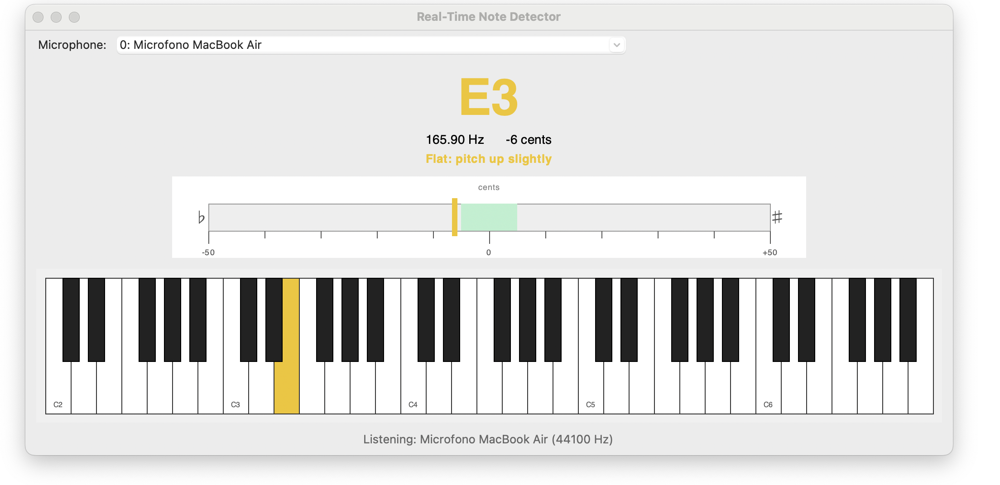

# Real-Time Note Detector

A real-time musical note recognition application featuring a graphical user interface (GUI), live pitch analysis, a tuning meter, and an interactive virtual piano keyboard.

---

## Features

- **Live Pitch Detection:** Uses FFT-based autocorrelation to detect fundamental frequencies in real-time.
- **Visual Intonation Meter:** Shows cent deviations (flat/sharp/in-tune) with dynamic color feedback.
- **Virtual Piano Keyboard:** Highlights detected notes across a 5-octave span (C2–B6).
- **Multi-Device Support:** Automatically lists and lets you switch between available microphone input devices.



---

## Prerequisites & Dependencies

Make sure you have Python installed, then install the required libraries:

```bash
pip install numpy sounddevice